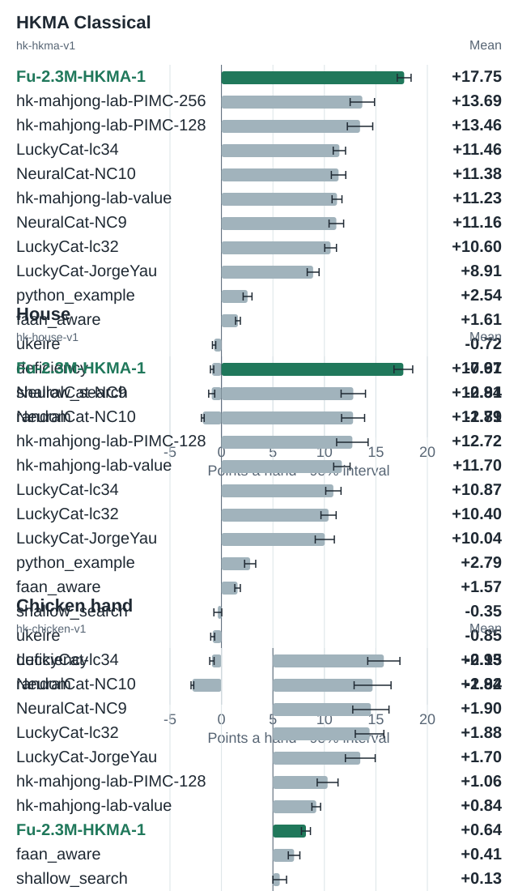

<div align="center">
<picture>
  <source media="(prefers-color-scheme: dark)" srcset="docs/assets/banner-dark.svg">
  <source media="(prefers-color-scheme: light)" srcset="docs/assets/banner-light.svg">
  
</picture>

A fair way to compare Hong Kong Mahjong players: bots today, LLMs and humans next.

<p>
  <a href="LICENSE"></a>
  
  
  
</p>
<p><a href="site/index.html">Leaderboard</a> · <a href="RESULTS.md">Results</a> · <a href="BENCHMARK_CARD.md">Benchmark card</a> · <a href="RULES.md">Rules</a> · <a href="SUBMITTING.md">Submit a bot</a></p>
</div>

## Why this exists

We build `Fu-2.3M-HKMA-1`, the bot that plays in the Mahjong Sensei app. We needed a fair way to tell whether a new version played better, and there was no benchmark for Hong Kong Mahjong. Most public mahjong AI work and its yardsticks focus on Japanese Riichi. We built this rules engine, scorer and harness to measure our bot, and are opening it so others can measure theirs on the same terms. The repository is MIT licensed and contains no private artifacts. LLM and human tracks will follow.

Mahjong is noisy: a strong player can lose a session on bad tiles, so raw win counts need a huge number of games. We reduce that luck with duplicate play, playing every wall four times with the bot in each seat once. We report points a hand against a frozen field of reference bots, with a 95% interval calculated over deals. Rules vary between tables, so every row names its rule set: HKMA Classical, House or Chicken hand. [RULES.md](RULES.md) spells out each one.

We need scores that bots cannot get by cheating or tuning to the test. Verified rows use a private deck that nobody outside sees. A bot gets only its own seat's view, and the fair-play check re-deals hidden tiles and asks again. Bots start fresh each game, and program bots run in a sandbox. Version [1.1.0 closed a hole that could have let a bot rebuild the private walls](CHANGELOG.md#110-2026-11-21).

It also helps with training. The bench is a fixed yardstick, so you can compare saved versions of a bot on deals it never trained on and know a gain is real. Public decks and `verify-log` make every public number reproducible, and `--training-log` saves each won hand's full record on public deals as training data. Head-to-head ratings compare bots directly. The protocol is plain JSON lines, so a program in any language can plug in.

## Results

<div align="center">
<picture>
  <source media="(prefers-color-scheme: dark)" srcset="docs/assets/results-dark.svg">
  <source media="(prefers-color-scheme: light)" srcset="docs/assets/results-light.svg">
  
</picture>
</div>

Each panel has its own axis. Points cannot be compared across tables because the rules and payouts differ. The whiskers show 95% intervals. [Rebuild the chart](scripts/render_charts.py) from the result files with `python3 scripts/render_charts.py`.

These are the verified private-deck results from 20 to 22 November 2026, using version 1.1.0. Each table shows `Fu-2.3M-HKMA-1` and the other bot with the highest points a hand.

| Table | Bot | Points a hand [95% interval] | Win | Deal-in |
|---|---|---|---|---|
| `hk-hkma-v1` | `Fu-2.3M-HKMA-1` | +17.75 [+17.08, +18.42] | 47.2% | 3.4% |
| `hk-hkma-v1` | `hk-mahjong-lab-PIMC-256` | +13.69 [+12.50, +14.87] | 53.0% | 2.4% |
| `hk-house-v1` | `Fu-2.3M-HKMA-1` | +17.67 [+16.76, +18.58] | 37.4% | 4.9% |
| `hk-house-v1` | `NeuralCat-NC9` | +12.81 [+11.62, +13.99] | 23.9% | 4.6% |
| `hk-chicken-v1` | `Fu-2.3M-HKMA-1` | +0.64 [+0.55, +0.73] | 47.8% | 13.5% |
| `hk-chicken-v1` | `LuckyCat-lc34` | +2.15 [+1.84, +2.47] | 11.4% | 22.1% |

### Outside bots on the bench

`LuckyCat-lc32`, `LuckyCat-lc34`, `NeuralCat-NC9`, `NeuralCat-NC10`, `LuckyCat-JorgeYau`, `hk-mahjong-lab-value`, `hk-mahjong-lab-PIMC-128` and `hk-mahjong-lab-PIMC-256` are now leaderboard rows and appear on the chart. The maintainers ran them from their authors' public code; the authors did not submit them and can replace them with their own submission. [Outside bots on the bench](RESULTS.md#outside-bots-on-the-bench) gives the method, results and approximations. On Chicken hand every outside bot scores above `Fu-2.3M-HKMA-1`, which trained on HKMA rules.

## Why the run is fair

The private deck was new and stayed secret. Program bots ran in a sandbox with no network or access to the deck. Lucky Cat's Python adapter starts its own JavaScript, so its sandbox permits a child process. The original 51 runs passed the fair-play check with 0 decision changes and 0 view mismatches; none exceeded the fault limit. All 283,800 original public games replayed with 0 mismatches. The 44 outside-bot runs and three new head-to-heads also passed the fair-play check with 0 faults; every secret-deck run is verified, and all 22 new public logs replay with 0 mismatches. The bench checked the pinned reference hashes and engine fingerprints before scoring.

The [full results and verification notes](RESULTS.md) include every bot on both decks, head-to-head ratings, the limits of the verified tag and commands to check the public runs. `Fu-2.3M-HKMA-1` was trained on HKMA Classical rules; House and Chicken hand use rules it was not trained for.

## Three rule sets

| Table | Rules | State |
|---|---|---|
| `hk-hkma-v1` | HKMA Classical: 3 faan to win, cap 10, discarder pays the whole hand, flowers do not score | scoring |
| `hk-house-v1` | House: flowers score, limit hands graded, cap 13, Seven Pairs is a hand | scoring |
| `hk-chicken-v1` | Chicken hand: HKMA Classical with a 0-faan minimum, so a hand with no scoring pattern wins; faan still score and pay | scoring |

HKMA Classical is the headline because it has a citable rulebook. `RULES.md` lists every faan value, the payout, and the places where `hk-hkma-v1` is not the rulebook.

## Quick start

You need Python 3.9 or newer. There are no packages to install.

```
git clone https://github.com/vnguyen9/mjss-hongkong-mahjong-bench.git
cd mjss-hongkong-mahjong-bench
python -m unittest discover -s tests          # or: python -m pytest tests
```

Reproduce a row of the leaderboard with one command (about a minute for the fast bots):

```
python -m hkbench score --table hk-hkma-v1 --bot ref:ukeire --deals 200 --workers 2
```

It prints points a hand with its 95% interval, win rate, deal-in rate, average win and limit hands. It also writes one result file and a compressed log of every game to `results/`. The run is tagged **unverified**, because it used the public deals.

Each log line is one game: the deal, the arrangement, who won and how, the faan and its `patterns` (`[name, faan]` pairs), the payments, and on public deals the seed and the full action list, so `verify-log` can replay it. To train on the games, add `--training-log` (to `score` or `h2h`; off by default, and with it off the logs are unchanged). Each won game's line then also carries the winner's `melds` (`[kind, tiles, seat the claimed tile came from]`), `concealed` tiles with the winning tile in them, `winning_tile` (null for a flower win), `flowers`, and `winner_draws`, the winner's own draw count from the engine's events. Tiles use the engine's names (`m1`..`m9`, `s1`.., `p1`.., `E S W N`, `C F P`). Seed plus actions rebuild any state, so nothing else is stored. The setting is for public deals: on a private deck the flag is ignored and the log stays outcome-only. The `game_over` message a bot receives (`protocol/PROTOCOL.md`) does not change.

## Submit a bot

Read [the submission guide](SUBMITTING.md) for the protocol, fair-play checks and the files to include.

You can score your own bot with any program that reads one JSON object per line on stdin and writes one per line on stdout (`protocol/PROTOCOL.md`):

```
python -m hkbench score --table hk-hkma-v1 \
    --bot "python examples/bots/python_bot.py" --name my_bot --trained-on "none" --deals 200 --workers 2
python -m hkbench score --table hk-hkma-v1 --bot "node examples/bots/javascript_bot.js" --deals 50
```

Other commands:

```
python -m hkbench h2h --table hk-hkma-v1 --bot a=ref:ukeire --bot b="python examples/bots/python_bot.py" --deals 100
python -m hkbench fairplay --table hk-hkma-v1 --bot "python examples/bots/python_bot.py"
python -m hkbench fingerprint --table hk-hkma-v1          # does this engine reproduce the table's fingerprint?
python -m hkbench verify-log results/logs/<file>.jsonl.gz # replay every game in a log
python -m hkbench site                                    # rebuild site/leaderboard.json and site/index.html
python -m hkbench tables                                  # list tables, check the reference field pins
```

(`python -m hkbench` works everywhere; `hkbench` is installed by `pip install -e .`.)

## How a row is scored

1. The reference bots must match their pinned hashes, and the engine must reproduce the table's fingerprint: 300 fixed deals and 42 fixed hands, hashed. If either fails, nothing is scored.
2. The bench plays the bot in real games on secret deals, re-shuffles every hidden tile (the other hands and the wall) at chosen decision points into a new arrangement that looks the same from the bot's seat, and asks again. A changed answer rejects the bot.
3. The bot takes one seat and the three field bots fill the others. Every deal is played from all four seats.
4. The bench computes one average per deal, then the mean and a 95% interval over deals. The four games of a deal are not independent, so the deal is the unit.

Public deals are in the repository. The deal deck used for **verified** rows is private and is read from a file outside the repository (`--private-seeds`, or the `HKBENCH_PRIVATE_SEEDS` environment variable). Make one with `python scripts/make_private_deck.py --count 10000 --out /path/outside/the/repo/deck.json`: independent random seeds, never a start and a count (the bench refuses that old form).

A bot never sees the deal's seed. Each decision's `rng_seed` and each game's `game_id` are HMAC-SHA256 outputs under a per-run key: random for a private deck and held only by the bench, fixed and public for a public deck so public runs repeat exactly. A program bot is started afresh for every game and given only a short allowlist of environment variables (`--bot-env NAME` hands over more). Results record `"rng_scheme": "hmac-sha256-v2"`.

## What is in here

```
hkbench/           the engine, the harness, the reference bots, the CLI
tables/            frozen, versioned tables: rules, field pins, deal range, engine fingerprint
protocol/          PROTOCOL.md and schema.json
scripts/           render_rules.py, render_charts.py, make_private_deck.py, and sandbox/macos.sh
docs/assets/       the banner and results chart, light and dark
examples/bots/     a Python bot and a JavaScript bot that pass the harness
results/           one JSON per scored run, and compressed per-game logs
site/              the static leaderboard (index.html and leaderboard.json)
tests/             scoring goldens, engine fingerprint, statistics, protocol, fair play, determinism
```

More: `BENCHMARK_CARD.md` (what the bench measures and where it is weak), `RULES.md`, [`SUBMITTING.md`](SUBMITTING.md), `CHANGELOG.md`.

## Tracks

The leaderboard has three tracks: **Bots**, **LLMs** and **Humans**. Only the Bots track has results so far.

## Citation

```bibtex
@misc{hongkongmahjongbench2026,
  title = {Hong Kong Mahjong Bench},
  year = {2026},
  howpublished = {\url{https://github.com/vnguyen9/mjss-hongkong-mahjong-bench}},
  note = {Version 1.1.0}
}
```
